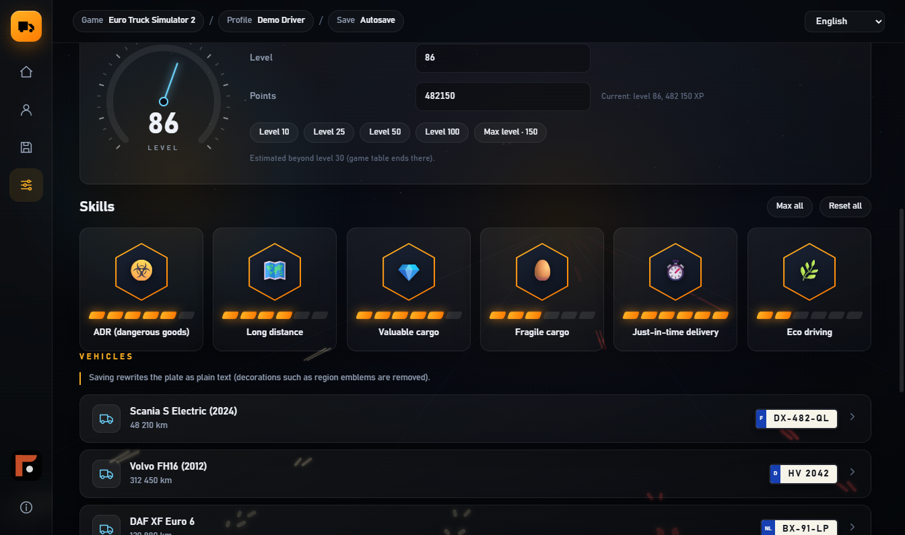
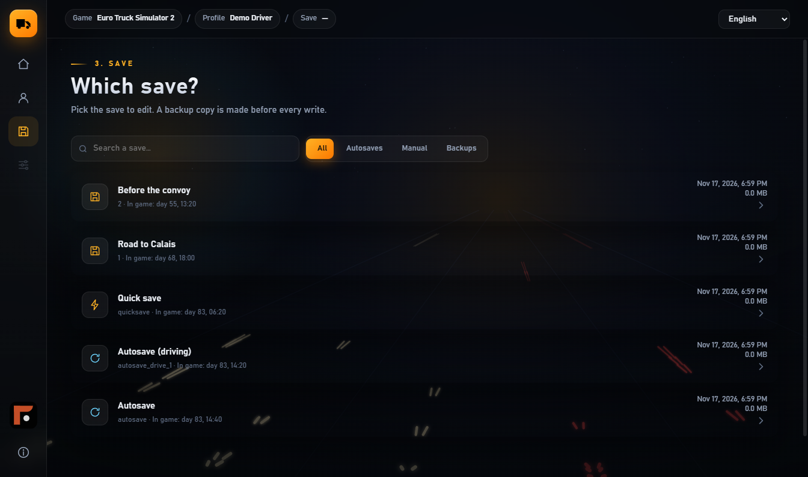
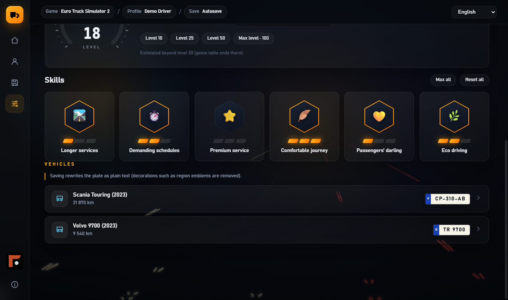

<p align="center"></p>

<h1 align="center">Truck Tools</h1>

<p align="center">
  A profile and save editor for <b>Euro Truck Simulator 2</b> and <b>American Truck Simulator</b>.<br>
  Pick a game, a profile and a save. Change what you want. Save. Play.
</p>

<p align="center">
  <a href="https://github.com/FarboundStudios/truck-tools/releases/latest"><b>Download</b></a> ·
  <a href="https://farboundstudios.com">Farbound Studios</a> ·
  <a href="https://buymeacoffee.com/farboundstudios">Donate</a>
</p>

<p align="center"></p>

## Features

- **Any game, profile and save.** ETS2 and ATS, local profiles and Steam Cloud profiles. Saves show their real names (the name you gave them in game, or "Autosave", "Quick save", "Multiplayer backup"…), the in-game clock and the file date.
- **Experience.** Set the XP of trucks and coaches by **level** (with an animated gauge) or by raw points, using the game's own level table.
- **Skills.** Click the pips: 6 ranks for trucks (ADR, long distance, valuable cargo, fragile cargo, just-in-time delivery, eco driving), 3 ranks for coaches (longer services, demanding schedules, premium service, comfortable journey, passengers' darling, eco driving). "Max all" / "Reset all".
- **Money.** Balance and loan limit.
- **Vehicles and trailers.** License plate and country, fuel, odometer, engine / transmission / cabin / chassis wear, trailer cargo weight, cargo damage and trailer wear. Vehicles show their real names (`volvo.fh16_2012` → *Volvo FH16 (2012)*).
- **Two tabs.** *Initial Game* and *Coaches DLC*. Coaches only exist in ETS2, so ATS has no Coaches tab.
- **Safe by design.** A backup copy of the save is made before every write, the write is refused while the game is running, and the file is read back and checked afterwards.
- **6 languages.** English, Français, Deutsch, Español, Italiano, Nederlands.
- **Auto-update.** Checks the GitHub releases and updates itself (checksum verified). Can be turned off.
- **Portable.** One `.exe`, nothing to install.

<p align="center">
  
  
</p>

## Download

Get **`TruckTools-<version>-portable.exe`** from the [latest release](https://github.com/FarboundStudios/truck-tools/releases/latest) and run it. Windows 10/11, 64-bit.

> The executable is not code-signed yet, so Windows SmartScreen may show a warning the first time ("More info" → "Run anyway"). The source is here, and every release is built by the [release workflow](.github/workflows/release.yml).

**Close the game before you save.** If the game is running when you write a save, it overwrites your changes on exit; Truck Tools refuses to write in that case.

## How it works

Profiles are read from `Documents/Euro Truck Simulator 2` and `Documents/American Truck Simulator` (`profiles` and `steam_profiles`).

| Save format | Read | Write |
| --- | --- | --- |
| Text (`g_save_format 2`) | yes | targeted line edits; the rest of the file is untouched |
| Encrypted text (ScsC) | yes | written back as plain text (the game reads it) |
| Binary (BSII, with or without ScsC) | economy, bank, XP and skills | the bytes of the edited fields are patched in place; the rest stays byte-for-byte identical; written unencrypted |

Vehicles and trailers can only be edited in **text** saves (for example autosaves). In binary saves their part of the file is not decoded safely, so Truck Tools leaves it alone instead of guessing.

Backups go to `<profile>/_trucktools_backups/<save>_<date>/`. To undo a change, copy the file back.

## Known limits

- **ATS Car mode (courier jobs)** is not supported yet. Its data lives in `car_job_log` entries and I need a save that contains car jobs to map them safely. Pull requests welcome.
- The game's XP table only covers the first 30 levels. Above that, Truck Tools assumes every level costs as much as the last one, and the maximum levels (truck 150, coach 100) are estimates.
- Writing binary (BSII) saves as unencrypted files has been checked by reading them back, but not in every game version.
- Plates are rewritten as plain text; decorations such as region emblems are removed.

## Build from source

Requires Node.js 22 or newer.

```bash
git clone https://github.com/FarboundStudios/truck-tools.git
cd truck-tools
npm ci
npm start          # run the app
npm test           # unit tests
npm run dist       # portable .exe in dist/
```

Project layout:

```
electron/   main process, preload bridge, GitHub updater
src/core/   save reading/writing (text, ScsC, BSII), profiles, XP tables, vehicles
ui/         interface (vanilla JS, no build step), translations in i18n.js
test/       tests, demo data, screenshot and social-image generators
docs/       screenshots, brand assets, social images
```

To add something editable, add an entry to [`src/core/props.js`](src/core/props.js) (economy, XP, skills) or [`src/core/vehicles.js`](src/core/vehicles.js) (vehicles, trailers), then its translation keys in `ui/i18n.js`.

### Screenshots and social images

`node node_modules/electron/cli.js test/shot-main.cjs docs/screenshots en` renders the screenshots from **made-up demo data** (no personal data). `node node_modules/electron/cli.js test/social-main.cjs` renders the images in `docs/social/`.

### Publishing a release

```bash
npm version minor          # or patch / major
git push && git push --tags
```

The workflow builds the portable executable and attaches it to the release. The app's updater only offers a release that has a `TruckTools-X.Y.Z-portable.exe` asset and a SHA-256 digest (GitHub adds the digest automatically). To sign builds, add the repository secrets `CSC_LINK` (base64 `.pfx`) and `CSC_KEY_PASSWORD`.

## Privacy

Truck Tools works offline. The only network request is the update check on `api.github.com`, which sends no personal data and can be disabled in *About*.

## License

[Truck Tools Open License](LICENSE) © 2026 [Farbound Studios](https://farboundstudios.com): MIT, plus one condition. You can use, modify and redistribute it freely, but a project built with it must say so (README, About screen, release notes):

> Built with Truck Tools by Farbound Studios - https://farboundstudios.com

The names and logos of Truck Tools and Farbound Studios are not licensed. Third-party components keep their own licenses: [Electron](https://www.electronjs.org/) and [electron-builder](https://www.electron.build/) (MIT).

*Truck Tools is an independent fan project. It is not affiliated with or endorsed by SCS Software. Euro Truck Simulator 2 and American Truck Simulator are trademarks of SCS Software.*

<p align="center"><br><b>Made by</b><br><a href="https://farboundstudios.com"></a></p>
